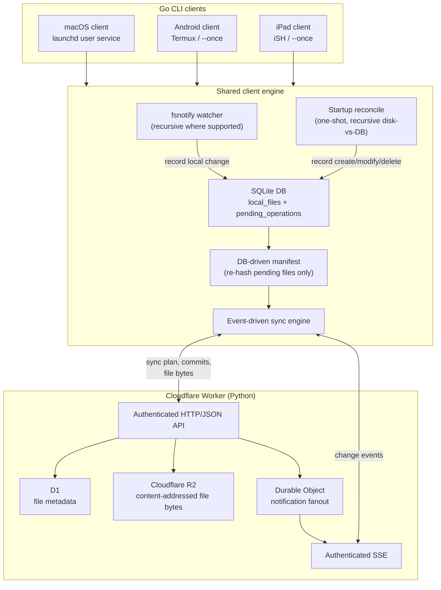

# Data Sync

A self-hosted file storage and synchronization system similar to iCloud. Local-first clients on multiple machines, centralized durable storage in the cloud, and incremental sync that works offline.

## Architecture



## How it works

- **Client** watches a folder recursively with fsnotify. Every event is written to a local SQLite DB (`local_files` + `pending_operations`) as a create/modify/delete op, along with the file's size and SHA-256 hash.
- At **startup** a one-shot, recursive reconcile walks disk vs DB to catch anything the watcher missed while the process was down.
- On every **sync pass** (initially and after each local filesystem event) the client builds a *DB-driven manifest* (re-hashing only files with pending ops), sends it to the Worker, and executes the returned plan. The manifest's `last_seen_hash` lets the planner distinguish a local edit from an unchanged local file; no separate local-change field is required.
- Local deletions are propagated explicitly: the Python Worker stores a tombstone in D1 and publishes a notification through the EventHub Durable Object. The Worker then tells other clients to DELETE it, never offers a tombstoned file as a download, and new devices never receive it.
- The **Python Worker** computes the plan by comparing the client's manifest against D1 metadata. Bytes go to the shared R2 bucket under content-addressed keys, so files are immutable and deduplicated. Upload and download are whole-file HTTP transfers written atomically on the client.
- Commits use **last-commit-wins** semantics: the latest accepted upload or delete replaces the current D1 metadata. The EventHub Durable Object is used only for live notification fanout, not as the metadata store.

## Current scope / known gaps

- Whole-file transfer; chunked upload + resumable is deferred.
- The Python Worker uses last-commit-wins; the legacy Rust Worker still uses first-writer-wins.
- Deletions propagate via D1 tombstones; tombstone garbage collection is deferred, so tombstones are kept forever.
- New directories are added to the watcher as they are created.
- HTTP API and SSE connections are authenticated with a bearer token.
- The Python Worker is deployed separately at
  `https://data-sync-python.shivangnag.workers.dev` while the Rust Worker remains available for rollback.
- The migration uses a clean D1 metadata database and the existing `data-sync-files-v2` R2 bucket. Existing server metadata and blobs were intentionally discarded; clients must re-upload local files.
- D1 schema creation currently runs on first request and should later be replaced with a migration.

## Personal deployment and development notes

This section contains the setup instructions for my local development and
Cloudflare deployment workflow.

### Configure the client

From the repository root:

```sh
cp .env.example .env
```

Set the same dedicated random token in `.env` that is configured as the
Worker's `SYNC_TOKEN` secret:

```env
SYNC_HTTP=https://data-sync-python.shivangnag.workers.dev
SYNC_TOKEN=your-dedicated-sync-token
SYNC_FOLDER=./data
SYNC_DB=./data-sync.db
```

`.env` is ignored by Git. Never commit the token or reuse an account password
as the sync token.

### Run the client

The normal daemon watches the configured folder recursively. A local file
create, edit, or delete immediately triggers a sync. Remote changes trigger a
sync through authenticated SSE:

```sh
go run ./cmd/client
```

For a single reconciliation pass:

```sh
go run ./cmd/client --once
```

Equivalent Make targets:

```sh
make run-client
make run-client-once
make test
```

### Build mobile clients

The Android target builds a statically linked ARM64 binary for Android:

```sh
make build_android_client
```

The iPad target builds a Linux 386 binary for iSH, which runs a Linux
userspace on iPad:

```sh
make build_ipad_client
```

The generated binaries are written to:

```text
data/android/sync-client-arm64
data/ipad/sync-client-ipad
```

### Run the Python Worker locally

Run the Python Worker from its directory:

```sh
cd python_worker
uv run pywrangler dev --local --port 8787 --var SYNC_TOKEN:dev-token
```

Then temporarily use this endpoint in `.env`:

```env
SYNC_HTTP=http://localhost:8787
SYNC_TOKEN=dev-token
```

Check the local Worker:

```sh
curl http://localhost:8787/health
```

Expected response:

```text
ok
```

### Deploy the Python Worker

Authenticate Wrangler once:

```sh
wrangler login
```

Configure the production token without placing it in source code:

```sh
cd python_worker
uv run pywrangler secret put SYNC_TOKEN
```

Deploy:

```sh
uv run pywrangler deploy
```

The Worker configuration is in
[python_worker/wrangler.toml](./python_worker/wrangler.toml). The Worker uses
D1 for metadata, the existing R2 bucket for file bytes, a minimal Durable
Object for notification fanout, and authenticated SSE for change notifications.
`uv` is used by the Python Worker toolchain to resolve and deploy dependencies;
it is not installed or run by the deployed Worker.

### Inspect local development data

Wrangler stores local Python Worker R2, D1, and Durable Object state under:

```text
python_worker/.wrangler/state/v3/
```

The directory is ignored by Git. Stop Wrangler before making manual changes to
its SQLite files.
